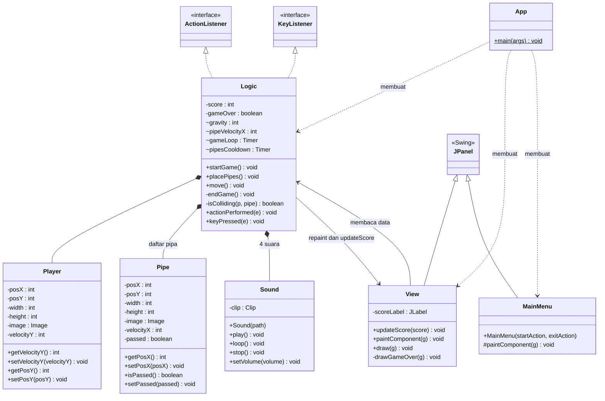
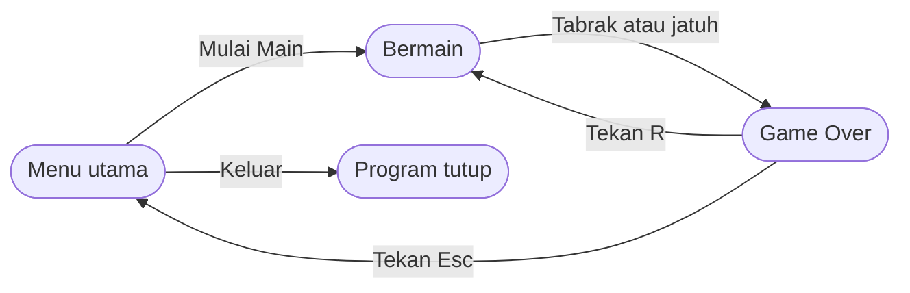

# TP6 DPBO - Flappy Bird (Java Swing GUI)

Nama : Ariq Ahmad Fathir
NIM : 2506752
Kelas : C2

## Janji

Saya Ariq Ahmad Fathir dengan NIM 2506752 mengerjakan TP 6 dalam mata kuliah
Desain dan Pemrograman Berorientasi Objek untuk keberkahan-Nya, maka saya tidak melakukan
kecurangan seperti yang telah dispesifikasikan. Aamiin.

## Tentang Programnya

Aplikasi ini adalah permainan Flappy Bird berbasis desktop yang dibuat dengan Java Swing. Pemain
mengendalikan seekor burung yang terus jatuh karena gravitasi, lalu menekan spasi agar burung
melompat dan melewati celah di antara pipa. Setiap satu pasang pipa yang berhasil dilewati menambah
skor satu poin. Permainan berakhir bila burung menyentuh pipa atau jatuh ke batas bawah layar.

Fitur utama:

- Menu utama dengan tombol Mulai Main dan Keluar
- Burung dengan gravitasi dan lompatan, serta pipa yang muncul dengan celah acak
- Skor yang tampil di bagian atas layar dan bertambah setiap melewati sepasang pipa
- Layar Game Over yang menampilkan skor akhir, dengan pilihan main lagi atau kembali ke menu
- Musik latar dan efek suara (lompat, skor bertambah, tabrakan)

Kontrol permainan:

| Tombol | Fungsi                                         |
| ------ | ---------------------------------------------- |
| Spasi  | Burung melompat                                |
| R      | Mengulang permainan dari awal (saat Game Over) |
| Esc    | Kembali ke menu utama (saat Game Over)         |

Teknologi yang dipakai: Java, Swing (JFrame, JPanel, JLabel, JButton, Timer), dan Java Sound API.

## Struktur Folder

```
TP6DPBO2526C2
├── FlappyBird
│   └── src
│       ├── App.java        titik awal program, menyusun jendela dan pergantian tampilan
│       ├── MainMenu.java   tampilan menu utama
│       ├── View.java       kanvas permainan (menggambar)
│       ├── Logic.java      aturan permainan dan input keyboard
│       ├── Player.java     model data burung
│       ├── Pipe.java       model data pipa
│       ├── Sound.java      pemutar audio
│       └── assets          gambar (png) dan audio (wav)
├── Dokumentasi             video program yang dijalankan
├── .gitignore
└── README.md
```

## Desain Program

### Tampilan

Program memakai satu jendela berukuran 360 x 640 piksel. Di dalamnya ada dua tampilan yang
ditumpuk dengan `CardLayout`, sehingga hanya satu yang terlihat pada satu waktu:

1. **Menu utama**: latar langit, gambar burung, judul, serta dua tombol (Mulai Main dan Keluar).
2. **Layar permainan**: latar, pipa, burung, dan label skor di tengah bagian atas. Saat permainan
   berakhir, layar diberi lapisan gelap transparan dengan tulisan Game Over, skor akhir, dan
   petunjuk tombol.

### Class Diagram



### Penjelasan Class

`Player` dan `Pipe` adalah model data. Keduanya hanya menyimpan posisi, ukuran, gambar, dan
kecepatan, beserta getter dan setter. `Pipe` memiliki atribut `passed` sebagai penanda bahwa pipa
sudah dilewati, agar skor tidak dihitung berulang.

`Sound` membungkus pemutaran satu berkas WAV. Berkas dimuat sekali ke memori lalu dapat diputar
satu kali (`play`), diulang terus-menerus (`loop`), atau dihentikan (`stop`). Bila perangkat suara
tidak tersedia, class ini tidak melempar error sehingga permainan tetap berjalan tanpa suara.

`Logic` adalah pusat aturan permainan. Class ini mengimplementasikan `ActionListener` agar dapat
dipanggil oleh `Timer` pada setiap frame, dan `KeyListener` untuk menerima input keyboard. Ada dua
`Timer`: `gameLoop` (sekitar 60 kali per detik) untuk menggerakkan permainan, dan `pipesCooldown`
(setiap 1,5 detik) untuk memunculkan pasangan pipa baru.

| Method           | Fungsi                                                                                  |
| ---------------- | --------------------------------------------------------------------------------------- |
| `startGame()`    | Mengembalikan semua data ke kondisi awal, menjalankan kedua Timer, dan memutar musik     |
| `placePipes()`   | Membuat pipa atas dan pipa bawah dengan posisi acak dan celah yang selalu sama besar     |
| `move()`         | Menerapkan gravitasi, menggerakkan pipa, mengecek tabrakan, menambah skor, membuang pipa |
| `isColliding()`  | Mengecek apakah kotak burung dan kotak pipa saling tumpang tindih                        |
| `endGame()`      | Menghentikan Timer dan musik, memutar efek tabrakan, lalu menandai game over             |
| `keyPressed()`   | Spasi untuk melompat, R untuk mengulang, Esc untuk kembali ke menu                       |

`View` adalah kanvas permainan. Class ini hanya menggambar apa yang ada di `Logic`: latar, pipa,
burung, lalu lapisan Game Over bila permainan sudah berakhir. Skor ditampilkan pada sebuah
`JLabel` yang diperbarui lewat `updateScore()` setiap kali skor berubah.

`MainMenu` adalah tampilan menu utama. Aksi tombolnya diberikan dari luar lewat constructor,
sehingga class ini tidak perlu mengetahui cara permainan dimulai.

`App` membuat jendela, menyambungkan `Logic` dengan `View`, lalu memasang menu dan layar permainan
pada `CardLayout`.

### Parameter Permainan

Nilai berikut ada di bagian atas `Logic.java` dan dapat diubah untuk menyesuaikan tingkat kesulitan.

| Parameter       | Nilai       | Keterangan                                         |
| --------------- | ----------- | -------------------------------------------------- |
| `gravity`       | 1           | Tambahan kecepatan turun pada setiap frame         |
| `jumpVelocity`  | -10         | Kecepatan vertikal saat melompat (negatif = naik)  |
| `pipeVelocityX` | -2          | Kecepatan pipa bergerak ke kiri per frame          |
| `openingSpace`  | 160 piksel  | Tinggi celah antara pipa atas dan pipa bawah       |
| Jeda pipa       | 1500 ms     | Selang waktu antar pasangan pipa                   |

## Alur Program



1. Saat dijalankan, `App` membuat jendela dan menampilkan menu utama. Timer belum berjalan.
2. Tombol Keluar menutup program. Tombol Mulai Main menampilkan layar permainan, memanggil
   `startGame()`, lalu mengarahkan fokus keyboard ke `View`.
3. `startGame()` menempatkan burung di tengah layar, mengosongkan daftar pipa, mengatur skor ke 0,
   menjalankan kedua Timer, dan memutar musik latar.
4. Pada setiap tick `gameLoop`, `actionPerformed()` memanggil `move()` lalu `repaint()`. Di dalam
   `move()`: kecepatan burung bertambah oleh gravitasi, posisinya diperbarui, setiap pipa
   digeser ke kiri, dan tabrakan dicek.
5. Setiap 1,5 detik `pipesCooldown` memanggil `placePipes()` untuk menambah sepasang pipa di tepi
   kanan layar, dengan posisi vertikal yang diacak.
6. Menekan spasi mengubah kecepatan burung menjadi -10 sehingga burung naik, sambil memutar efek
   lompat.
7. Ketika burung melewati tepi kanan sebuah pipa atas, skor bertambah satu dan label diperbarui.
   Pipa yang sudah keluar dari sisi kiri layar dihapus dari daftar.
8. Jika burung menyentuh pipa atau mencapai batas bawah layar, `endGame()` menghentikan kedua
   Timer sehingga semua objek berhenti, mematikan musik latar, dan memutar efek tabrakan. `View`
   menampilkan lapisan Game Over beserta skor akhir.
9. Pada kondisi Game Over, tombol R memanggil `startGame()` lagi untuk mengulang dari awal, dan
   tombol Esc mengembalikan pemain ke menu utama.

## Cara Menjalankan

Kebutuhan: JDK 11 atau yang lebih baru. IntelliJ IDEA bersifat opsional.

**Lewat IntelliJ IDEA**

1. Buka folder `FlappyBird` sebagai project, lalu tandai folder `src` sebagai Sources Root
   (klik kanan `src` > Mark Directory as > Sources Root).
2. Jalankan `App.java`.

**Lewat terminal**

Dari dalam folder `FlappyBird`:

```
mkdir out
javac -d out src/*.java
```

Salin folder gambar dan audio ke hasil kompilasi, lalu jalankan:

```
# Linux / macOS
cp -r src/assets out/assets
java -cp out App

# Windows (Command Prompt)
xcopy src\assets out\assets /E /I
java -cp out App
```

Gambar dan audio dibaca dari classpath (`assets/...`), sehingga folder `assets` harus berada
di samping file `.class`. IntelliJ melakukannya secara otomatis.

## Dokumentasi

Video program yang dijalankan: [Dokumentasi/demo.mp4](Dokumentasi/demo.mp4)

<video src="https://github.com/ariqahmadf-alt/TP6DPBO2526C2/raw/main/Dokumentasi/demo.mp4" controls width="360"></video>

Video memperlihatkan menu utama, permainan berjalan beserta skor, layar Game Over, mengulang
permainan dengan tombol R, dan keluar dari program.
